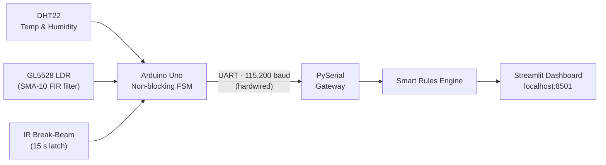

<div align="center">

# ClimaCore Smart Building System

### ELEE1148 · Demand-Controlled HVAC at the Edge


_An IoT solution designed for sophisticated demand-controlled heating, ventilation, and air conditioning (HVAC) systems._

</div>

---

## Table of Contents

## Table of Contents

- [About the Project](#about-the-project)
- [Features](#features)
- [System Architecture](#system-architecture)
- [Tech Stack](#tech-stack)
- [Getting Started](#getting-started)
  - [Prerequisites](#prerequisites)
  - [Installation & Usage](#installation--usage)
- [Project Structure](#project-structure)
- [Demo](#demo)
- [Author](#author)

---

## About the Project

ClimaCore is a real-time IoT edge node for dynamic environmental monitoring within smart building structures. By leveraging a non-blocking Finite State Machine (FSM) at the edge and a Streamlit-driven analytical gateway, the system achieves significant theoretical energy reductions via autonomous occupancy-based thermal setbacks.

### Problem it Solves

Commercial buildings consume a disproportionate share of global energy, largely driven by HVAC systems operating on inflexible, static schedules. These outdated systems constantly condition rooms independent of actual human behaviour or internal heat gains.

ClimaCore solves this by gathering high-fidelity, real-time data to implement demand-controlled HVAC strategies, decreasing total system loads and providing predictive diagnostics for thermal anomalies.

### Target Users

- Smart building and facility managers
- Commercial energy auditors
- IoT developers and engineers

---

## Features

| Feature Area            | Description                                                                                                                                   |
| :---------------------- | :-------------------------------------------------------------------------------------------------------------------------------------------- |
| **Climate Sensing**     | Measures temperature and humidity with high precision using a capacitive DHT22 sensor (accuracy of ±0.5°C).                                   |
| **Occupancy Detection** | Deterministically detects human presence using an IR Break-Beam sensor with a 15-second latching mechanism.                                   |
| **Signal Processing**   | Utilizes a 10-sample digital Finite Impulse Response (FIR) low-pass filter (SMA-10) to suppress ambient electrical noise from the LDR sensor. |
| **Data Security**       | Prevents wireless packet sniffing via a hardwired, asynchronous UART serial connection operating at 115,200 baud.                             |
| **Smart Rules Engine**  | Applies multivariable logic to trigger autonomous safety alerts (e.g., flagging `FIRE RISK` at >60.0°C) and HVAC economy modes.               |

---

## System Architecture



---

## Tech Stack

| Layer                   | Technologies                                                            |
| :---------------------- | :---------------------------------------------------------------------- |
| **Hardware**            | Arduino Uno (ATmega328P), Grove DHT22, GL5528 LDR, IR Break-Beam sensor |
| **Firmware**            | C++ (PlatformIO / Arduino framework)                                    |
| **Backend & Dashboard** | Python 3, Streamlit, PySerial, Pandas, Plotly                           |
| **Development Tools**   | VS Code, PlatformIO IDE                                                 |

---

## Getting Started

### Prerequisites

- VS Code with the **PlatformIO IDE** extension installed
- Python 3.9+ installed on your system
- An Arduino Uno connected via USB

### Installation & Usage

You will need to deploy the firmware to the Arduino first, then run the Python dashboard to read the data.

#### Step 1: Flash the Firmware

1. Open the project folder in VS Code.
2. Ensure the Arduino is plugged into your USB port.
3. Click the PlatformIO **Upload** button (the right-pointing arrow `→` in the bottom blue status bar) to compile and flash the `src/ClimaCore_Firmware.cpp` file to the board.

#### Step 2: Start the Dashboard

1. Open a new terminal in VS Code.
2. Install the required Python libraries:

```bash
   pip install streamlit pandas plotly pyserial numpy
```

3. Run the Streamlit gateway:

```bash
   streamlit run Dashboard.py
```

4. The dashboard will automatically open in your browser.

---

## Project Structure

```text
ClimaCore/
├── src/
│   └── ClimaCore_Firmware.cpp      # Non-blocking FSM and sensor polling logic
├── Dashboard.py                    # Streamlit UI and Smart Rules Engine gateway
├── platformio.ini                  # PlatformIO configuration and library dependencies
├── README.md                       # Project documentation
└── .gitignore                      # Git exclusion rules for compiled binaries
```

---

## Demo

[**Watch the ClimaCore System in Action**](https://youtu.be/nMzvC_xaJOQ)

---

## Author

- Name: Abhishil Sinoj
- GitHub: https://github.com/abhishilsinoj

---
